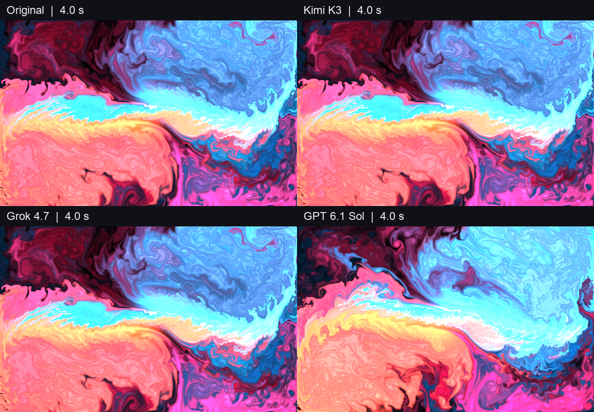

# REA 逆向评测

用相同环境比较模型通过 REA 分析程序、重建功能的表现。每个案例独立一个文件夹，公开输入、协议、提交物和验证方式，方便复测。

**非 REA 官方项目，不是模型综合排行榜。**

- [打开流体四格对比](https://adkid-zephyr.github.io/rea-benchmarks/benchmarks/001-webgl-fluid/web/)
- [观看同步视频](https://adkid-zephyr.github.io/rea-benchmarks/benchmarks/001-webgl-fluid/web/comparison.mp4)
- [案例 001：WebGL 彩色流体](benchmarks/001-webgl-fluid/README.md)
- [完整实验记录](benchmarks/001-webgl-fluid/REPORT.md)
- [参与复测 / 提交新案例](CONTRIBUTING.md)

## 首次试跑结果

| 模型 | 原始运行耗时 | 主场景 RGB 平均误差 | 新场景 RGB 平均误差 |
|---|---:|---:|---:|
| Kimi K3 | 276 秒 | 0.000 | 0.000 |
| Grok 4.7 | 279 秒 | 0.000 | 0.000 |
| GPT 6.1 Sol | 193 秒 | 29.056 | 6.716 |

每个场景取五张固定帧截图，误差范围0–255，越低越接近原版。每模型仅一次；耗时包含工具等待，不是严格速度基准。三个提交均可运行，无人工代修。

**局限必须一起传播：** 本案例可分段读取原始发布的 JavaScript，提示还提供了功能和关键参数，允许使用短着色器公式。因此它是区分度有限的产物分析与重建试跑，不是隐藏源码的二进制逆向，也不能证明 REA 带来了多少增益。像素一致只适用于已测的十张帧。

## 别人如何测

只看效果：克隆仓库，在根目录执行 `python3 -m http.server 8080`，访问 `http://localhost:8080/benchmarks/001-webgl-fluid/web/`，不需要模型账号。

核对公开结果：安装 `requirements.txt`，运行 `python3 scripts/verify.py`。

重新执行提交代码：根目录 `npm ci`、`npx playwright install chromium`，然后运行案例的 `scripts/evaluate.cjs`。详细命令见[英文首页](README.md)。

重新调用自己的模型：按[案例说明](benchmarks/001-webgl-fluid/README.md)配置兼容端点和独立输出目录；不会读取发布者的账号配置。只有这一步会调用模型并可能消耗额度。

## 协作原则

环境负责者只搭环境和做最终验收。参赛模型可以自己读产物、调用工具、自测与修复；不得接受母模型的代码修改、诊断建议或隐藏验收反馈。失败结果保留，不以最佳一轮替代全部尝试。公开审计排除内部推理和个人路径，保留工具调用元数据、测试反馈与代码版本。
